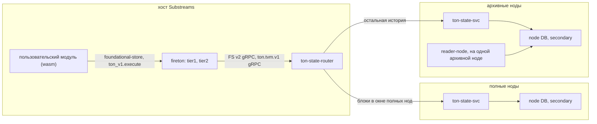

# Дизайн: TVM и стейты TON в substreams-модулях

Статус: предложение от 2026-10-21, кода пока нет.

Цель: дать пользовательским substreams-модулям TON то же, что есть в acton:
get-методы, эмуляцию транзакций и traces, стейт любого аккаунта на любом блоке
истории. Результаты должны быть детерминированными: substreams кэширует выходы
модулей по сегментам, и недетерминированный ответ портит кэш для всех.

## Исходные факты

Проверено по исходникам firecore v1.20.1 и substreams v1.23.0, используемых
на тестовом стенде, а также acton и substreams-foundational-store.

- acton (`ton-executor`) — тонкая Rust-обёртка над C++ `libemulator.a` из TON.
  Статические архивы собраны только под macOS и Linux (x86_64, arm64). В C API
  эмулятора acton дописал свои функции: EXTCALL-методы, missing-library
  callback, пошаговое исполнение. `ton-state` из acton отдаёт только последний
  стейт, исторических запросов нет.
- У нас нативный TVM уже используется:
  `tondb-scanner/src/smc-interfaces/execute-smc.cpp` (get-методы) и
  `ton-trace-emulator` (traces).
- В `sf.ton.type.v1.Block` для эмуляции не хватает:

  | Что нужно эмулятору | Что есть в блоке |
  |---|---|
  | config | только в key-блоках (`McBlockExtra.config`) |
  | публичные библиотеки | нет, только `library` аккаунта, когда он изменился |
  | полный стейт аккаунта | в `state_after` BOC code и data только если они изменились; data больше 64 KiB помечается `boc_omitted`; `state_before` без BOC; аккаунты zerostate без транзакций в блоках не появляются |
  | prev_blocks_info | нет, выводится из id mc-блоков |
  | now, lt, rand_seed | есть |

- В firehose-core есть `Chain.RegisterSubstreamsExtensions`: через него бинарь
  сети отдаёт модулям свои host-функции (так fireeth отдаёт `rpc.eth_call`).
  Функция расширения получает Clock текущего блока. Ошибка расширения
  превращается в panic, и движок считает её недетерминированной.
- Foundational store поддерживается движком с v1.16.6 и крейтом `substreams`
  0.7.6. Движок всегда запрашивает его на `Clock.Number`, то есть получает
  стейт после текущего блока. Если store отвечает `BlockReached=false`, движок
  повторяет запрос каждые 100 мс, пока данные не появятся. Вход модуля
  ссылается на store идентификатором `name@semver`; tier1 находит адрес по этому
  идентификатору в JSON-файле из `--substreams-tier1-foundational-stores-config-path`.
- tier1 исполняет не только голову. В production mode он берёт хвост не больше
  одного сегмента (1000 блоков) до последнего финального блока плюс live. В dev
  mode (`substreams run` без `--production-mode`, `substreams gui`) он исполняет
  модуль линейно от start block пользователя, который может быть сколь угодно
  старым.
- liteserver в `runSmcMethod` берёт rand_seed из `td::Random::secure_bytes`, то
  есть его ответ недетерминирован.

## Отвергнутые варианты

### TVM внутри wasm-модуля

- **C++ libemulator в wasm.** TVM построен на исключениях C++. emscripten-сборка
  эмулятора TON реализует их через JS (`-fexceptions`, импорты `invoke_*`), а JS
  в substreams нет. Нативные Wasm exceptions не поддерживает wazero, а у
  wasmtime-go v41 (рантайм по умолчанию в v1.23) нет настройки, чтобы их
  включить. Сверху — WASI-импорты и сборка OpenSSL, secp256k1 и blst под wasm.
  Без патча движка не взлетит.
- **TVM на чистом Rust.** В wasm собирается, но совпадение с C++ TVM по
  опкодам, газу и фазам транзакции никто не гарантирует. Это уже не «как в
  acton».

### Классический foundational store со стейтом всех аккаунтов

- Каждая версия каждого аккаунта хранится целиком, без общих ячеек. Версий
  примерно столько же, сколько транзакций за всю историю.
- Блоки не несут полный стейт (см. таблицу выше), модулю-наполнителю не из чего
  его собрать.
- Наполнение идёт строго последовательно: с блока 1 это займёт недели.
- Значение — непрозрачный блоб: TVM получает data целиком, без ленивой
  подгрузки ячеек.

Celldb архивной ноды уже хранит стейты каждого блока за всю историю без
дублирования ячеек. Поэтому протокол foundational store реализуем поверх неё.
Классический foundational store остаётся для небольших производных индексов:
jetton wallet → owner/master, code_hash → интерфейс.

## Архитектура



Модуль сам в сеть не ходит: он вызывает импорт хоста, а запрос делает процесс
tier1 или tier2. Firehose-часть (reader-node, merger, relayer, firehose) и сам
блок `sf.ton.type.v1.Block` не меняются.

- **fireton** — свой бинарь вместо firecore: тот же `main.go` плюс
  `RegisterSubstreamsExtensions` с namespace `ton_v1`. Само расширение — тонкий
  gRPC-клиент к роутеру, который передаёт ему текущий блок.
- **ton-state-router** (Go, на хосте Substreams) — один адрес и для foundational store
  (протокол FS v2), и для исполнения (`ton.tvm.v1`).
  - Знает у каждого бэкенда диапазон [нижняя граница, head] и направляет запрос
    по номеру блока.
  - Если до блока ещё никто не дошёл — ждёт. Если блок вне окна бэкенда —
    пересылает запрос дальше.
  - Может кэшировать ответы: они детерминированы. Это выгодно на голове, где все
    спрашивают один и тот же блок.
  - Держит лимиты.
- **ton-state-svc** (C++, новый бинарь в `ton-index-worker`) — secondary-инстанс
  к базе ноды. Читает стейты на mc-блоке и исполняет через libemulator прямо
  рядом с celldb, ячейки грузит лениво: большой data не перекачивается.
  Переиспользует DbScanner, CellCache, перевод Transaction → proto из
  `FirehoseBlock.cpp`, TraceEmulator и execute-smc. Отдельный процесс, а не код
  внутри tier2: падение нативного кода не роняет tier2, который обслуживает всех.

### Отставание нод

- Если сервис читает ту же базу, что и reader, substreams не может обогнать
  ноду: блок N попадает в Firehose только после того, как reader прочитал из
  этой базы и блок, и стейты блока N. Отставать может только secondary-инстанс
  самого сервиса, на доли секунды. Поэтому на запрос выше известного head сервис
  сразу подтягивает базу и ждёт.
- Если сервис на другой ноде, она может отставать по-настоящему. Правило одно:
  на блок N отвечать только стейтом блока N или «ещё нет». Отвечать «последним,
  что есть» нельзя (как `ETH_CALL_FALLBACK_TO_LATEST_DURATION` в
  firehose-ethereum): в кэш сегментов попадёт результат, зависящий от того,
  насколько отставала нода в момент запроса.
- Для головы хватает полных нод с окном `--state-ttl` (по умолчанию сутки).
  Маршрутизация идёт по номеру блока, а не по tier: dev mode заставляет tier1
  спрашивать старые блоки, а свежие сегменты tier2 могут уходить на полные ноды.
- Полная нода не отвечает `NOT_FOUND` на блок вне своего окна или на хэш,
  который она уже удалила. Движок примет это за «аккаунта нет», и ответ
  запечётся в кэш. Вне окна запрос пересылается на архивную ноду, а если некуда —
  возвращается недетерминированная ошибка.
- Нижнюю границу окна полной ноды держим с запасом: нода удаляет старые стейты
  постоянно, и secondary-инстанс может потерять файлы прямо во время чтения.
  Снапшот RocksDB держим только на время одного запроса, иначе удалённые нодой
  SST-файлы не освобождаются.

## Семантика

Общая для чтения стейтов и для исполнения.

- **Всё привязано к блоку модуля:** N = `Clock.Number` (mc seqno). Попросить
  другой блок нельзя — на этом держатся детерминизм и кэш.
- **Точка внутри блока (`At`):**
  - `after_block` (по умолчанию) — стейт после mc-блока N;
  - `before_block` — стейт после блока N−1;
  - `before_tx(lt)` и `after_tx(lt)` — между транзакциями. Промежуточных стейтов
    в celldb нет, поэтому сервис переигрывает транзакции аккаунта в шардовом
    блоке от его начального стейта и сверяет хэш каждой переигранной транзакции
    с настоящей.
- **Контекст VM по умолчанию:**
  - now и lt — из шардового стейта (gen_utime, gen_lt), как в liteserver;
  - config, библиотеки и prev_blocks_info — из mc-стейта N;
  - rand_seed — как у коллатора: sha256(rand_seed шардового блока ‖ адрес);
  - всё это можно переопределить в запросе.

## API стейтов: foundational store `ton_state@v1.0.0`

```yaml
modules:
  - name: map_pools
    kind: map
    inputs:
      - source: sf.ton.type.v1.Block
      - foundational-store: ton_state@v1.0.0
    output:
      type: proto:dex.v1.Pools
```

На tier1 адрес роутера задаётся файлом из
`--substreams-tier1-foundational-stores-config-path`:

```json
{"ton_state@v1.0.0": "<router>:<port>"}
```

Идентификатор с версией входит в хэш модуля.

Ключи (SDK их прячет):

| Ключ | Значение |
|---|---|
| `0x01 wc addr` | `ShardAccount` после блока N |
| `0x02 wc addr` | `ShardAccount` до блока N |
| `0x03 hash` | `Account` по хэшу его ячейки (`old_hash`/`new_hash` из `AccountBlock.state_update`) |
| `0x10` | config на блоке N |
| `0x11 hash` | библиотека на блоке N |
| `0x12` | контекст на блоке N: id последних mc-блоков, предыдущий key-блок, global version |

```proto
package ton.state.v1;

message ShardAccount {
  sf.ton.type.v1.Account account = 1;   // разобранный, как в блоках
  bytes boc = 2;                        // ячейка Account целиком
  bool boc_omitted = 3;                 // больше лимита: читать через get-методы
  bytes last_trans_hash = 4;
  uint64 last_trans_lt = 5;
  sf.ton.type.v1.BlockIdExt block = 6;  // шардовый блок, из стейта которого взят аккаунт
  uint32 gen_utime = 7;
  uint64 gen_lt = 8;
}
```

- Несуществующий аккаунт возвращается как `FOUND` с `account_none`.
- `NOT_FOUND` бывает, только если такого хэша нет даже на архивной ноде.
- `get_first` не поддерживается.

## API исполнения: импорт `ton_v1.execute`

Один импорт: на вход пачка вызовов, на выход пачка результатов. Так N вызовов
стоят одного перехода wasm → хост → gRPC.

```proto
package ton.tvm.v1;

message ExecuteRequest  { repeated Call calls = 1; }
message ExecuteResponse { repeated CallResult results = 1; }   // в порядке calls

message Call {
  oneof kind {
    GetMethod get_method = 1;
    Emulate emulate = 2;
    GetAccount get_account = 3;   // стейт в точке внутри раунда (before_tx/after_tx)
  }
}

message At {
  oneof point {
    Empty after_block = 1;
    Empty before_block = 2;
    uint64 before_tx = 3;          // lt транзакции этого аккаунта в текущем раунде
    uint64 after_tx = 4;
  }
}

message AccountSource {
  oneof source {
    bytes address = 1;             // wc + 32 байта: стейт из сети в точке At
    bytes account_boc = 2;         // готовый Account/ShardAccount от модуля
    StateInit state_init = 3;      // code + data + balance: «что если»
  }
}

message GetMethod {
  AccountSource account = 1;
  At at = 2;
  oneof method { string name = 3; int32 id = 4; }
  repeated StackEntry stack = 5;
  Context context = 6;
}

message Emulate {
  bytes message_boc = 1;                     // internal или external-in
  At at = 2;
  map<string, AccountSource> accounts = 3;   // подмена стейтов аккаунтов трейса, ключ "wc:hex"
  uint32 max_transactions = 4;               // 1 — одна транзакция, больше — трейс
  bool ignore_chksig = 5;                    // для внешних сообщений без ключей
  bool return_states = 6;
  Context context = 7;
}

message GetAccount { bytes address = 1; At at = 2; }

message Context {                            // всё необязательно, по умолчанию — из блока
  optional uint32 now = 1;
  optional uint64 lt = 2;
  optional bytes rand_seed = 3;
  map<int32, bytes> config_params = 4;       // подмена параметров config
  repeated bytes libraries = 5;              // дополнительные библиотеки
  optional uint64 gas_limit = 6;             // для get-методов, в пределах потолка
  bool vm_log = 7;                           // обрезается по размеру
}

message CallResult {
  Status status = 1;                         // OK, INVALID_REQUEST, TOO_LARGE, REPLAY_MISMATCH
  string error = 2;
  oneof result {
    GetMethodResult get_method = 3;
    EmulateResult emulate = 4;
    ton.state.v1.ShardAccount account = 5;
  }
}

message GetMethodResult {
  int32 exit_code = 1;
  uint64 gas_used = 2;
  repeated StackEntry stack = 3;
  repeated bytes missing_libraries = 4;
  string vm_log = 5;
}

message EmulateResult {
  bool external_not_accepted = 1;
  repeated Node transactions = 2;            // плоское дерево, как Node в ton-traces
  bool truncated = 3;                        // упёрлись в max_transactions
}

message Node {
  sf.ton.type.v1.Transaction transaction = 1;   // тот же тип, что в блоках
  bytes transaction_boc = 2;
  optional uint32 parent = 3;
  uint32 depth = 4;
  ton.state.v1.ShardAccount account_after = 5;  // если return_states
  string vm_log = 6;
}

message StackEntry {
  oneof value {
    Empty null = 1;
    bytes int = 2;        // big-endian со знаком, до 257 бит
    bytes cell = 3;       // BOC
    bytes slice = 4;      // BOC ячейки с остатком слайса
    bytes builder = 5;
    Tuple tuple = 6;
    Empty nan = 7;
  }
}
```

Трейс эмулируется целиком в контексте блока N: now фиксирован, lt растёт,
транзакции идут в порядке lt — как в нашем TraceEmulator. Задержки между
шардами не моделируются.

## Rust SDK `substreams-ton`

```rust
use substreams::store::FoundationalStore;
use substreams_ton::{pb::ton::Block, tvm, Address, At, State};

#[substreams::handlers::map]
fn map_pools(block: Block, store: FoundationalStore) -> Result<Pools, Error> {
    let state = State::new(store);
    let pools: Vec<Address> = touched_pools(&block);

    // стейты одним запросом, после блока
    let accounts = state.accounts(&pools)?;
    let config = state.config()?;

    // get-методы одним вызовом хоста
    let mut batch = tvm::batch();
    for pool in &pools {
        batch.get_method(pool, "get_pool_data");
    }
    for (pool, result) in pools.iter().zip(batch.execute()?) {
        let out = result.get_method()?;
        if out.exit_code == 0 {
            let reserve0 = out.stack.int(0)?;
            let reserve1 = out.stack.int(1)?;
        }
    }

    // эмуляция: что было бы до свопа, с подменённым кодом пула
    let trace = tvm::emulate(msg_boc)
        .at(At::BeforeTx(swap_lt))
        .ignore_chksig()
        .max_transactions(100)
        .account(&pool, tvm::Account::state_init(code, data, balance))
        .execute()?;
    // ...
}
```

Что войдёт в SDK:

- типы protobuf на prost под `substreams` 0.7;
- кодирование ключей foundational store;
- построители вызовов;
- помощники для стека: целые через num-bigint, адреса, ячейки. Для BOC хочется
  взять rston из acton (см. открытые вопросы).

## Ошибки и детерминизм

1. **Результат VM** приходит в ответе: exit_code, out of gas,
   `external_not_accepted`, `missing_libraries`. Он детерминирован и кэшируется.
2. **Плохой запрос** — `status` в ответе: `INVALID_REQUEST`, `TOO_LARGE`,
   `REPLAY_MISMATCH`. Тоже детерминирован: зависит только от запроса и блока.
3. **Инфраструктура** — нет бэкенда, таймаут, никто не дошёл до блока.
   Расширение возвращает ошибку, движок делает panic, ошибка считается
   недетерминированной: не кэшируется, запрос повторяется. В foundational store
   то же самое делает `BlockReached=false` с ретраями движка.

## Версии

- `ton_v1` и `ton_state@v1.0.0` — контракт. Импорт `ton_v1` зашит в wasm, а хэш
  модуля включает wasm и идентификатор store, поэтому переход на v2 сам по себе
  даёт новый кэш.
- Хэш модуля не учитывает версию эмулятора на бэкенде. Поэтому обновлять бэкенд
  внутри v1 можно, только если на старых блоках результаты не меняются —
  например, при добавлении новой global version. Перед выкаткой это проверяется
  эталонным набором переигранных исторических транзакций. Если результаты
  меняются — нужен v2, который работает рядом с v1.

## Лимиты

- потолок газа на один вызов;
- `max_transactions` для трейса;
- размер ответа на пачку;
- размер BOC стейта: сверх него `boc_omitted` или `TOO_LARGE`;
- vm_log только по запросу и с обрезкой.

## Порядок работ

1. Протоколы `ton.state.v1` и `ton.tvm.v1`, каркас SDK, fireton с
   `ton_v1.execute`, который пока отвечает заглушкой через роутер. Прогнать на
   голове и в tier2: передача параметров расширения из tier1 в tier2, кэш
   сегментов, метрики.
2. ton-state-svc на архивной ноде: чтение стейтов через foundational store — после и до
   блока, по хэшу, config, библиотеки.
3. get-методы.
4. Эмуляция одной транзакции, потом трейса; затем `before_tx` и `after_tx`.
5. Переигрывание реальных транзакций по диапазонам блоков: это и проверка
   корректности, и эталонный набор для правила версий.
6. Полные ноды для головы, маршрутизация по окнам, кэш в роутере.

## Открытые вопросы

- Собирается ли rston под wasm32 — не проверено.
- Авторизация и лимиты на пользователя. Пока наружу ничего не открываем.
- Нагрузка на основную архивную ноду, пока не подняты дополнительные
  архивные ноды: на ней уже reader-node и прод-лайтсервер.
- Какие старые транзакции текущий эмулятор не воспроизведёт: он переключает
  поведение по global version из config param 8, но не все исторические
  изменения так версионированы. Покажет шаг 5.
- Размер окна полных нод и запас у его нижней границы.
- Нужны ли дополнения блока для модулей без сервиса: изменения публичных
  библиотек, config в первом блоке, id предыдущего key-блока.
