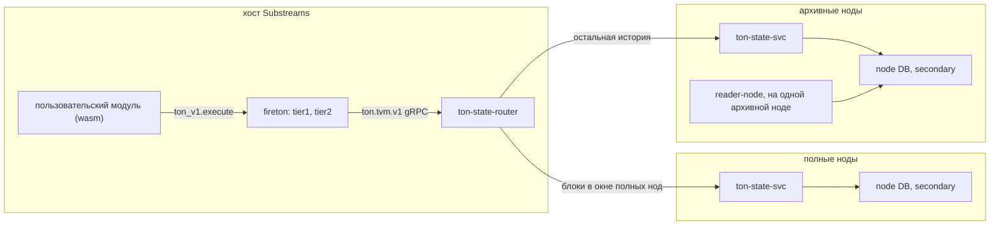

# Дизайн: TVM и стейты TON в substreams-модулях

Статус: предложение от 2026-10-21, кода пока нет.

Цель: дать пользовательским substreams-модулям TON то же, что есть в acton:
get-методы, эмуляцию транзакции, стейт любого аккаунта на любом блоке истории.
Результаты должны быть детерминированными: substreams кэширует выходы модулей
по сегментам, и недетерминированный ответ портит кэш для всех.

Эмулируется одна транзакция. Эмуляцию trace целиком, с исполнением исходящих
сообщений, не делаем: юзкейса пока нет, а проблем она добавляет много. В сети
транзакции trace идут в разных блоках и шардах, и эмуляция в контексте одного
блока даёт другой результат; размер trace ничем не ограничен; в запросе
пришлось бы подменять стейты многих аккаунтов.

Всё — чтение стейтов, get-методы и эмуляция — идёт через одно host-расширение
`ton_v1`. Foundational store не используется (см. «Отвергнутые варианты»).

## Исходные факты

Проверено по исходникам firecore v1.20.1 и substreams v1.23.0, используемых
на тестовом стенде, а также acton, substreams-foundational-store и TON из
`external/ton`.

- acton (`ton-executor`) — тонкая Rust-обёртка над C++ `libemulator.a` из TON.
  Статические архивы собраны только под macOS и Linux (x86_64, arm64). В C API
  эмулятора acton дописал свои функции: EXTCALL-методы, missing-library
  callback, пошаговое исполнение. `ton-state` из acton отдаёт только последний
  стейт, исторических запросов нет.
- У нас нативный TVM уже используется:
  `tondb-scanner/src/smc-interfaces/execute-smc.cpp` (get-методы) и
  `ton-trace-emulator` (транзакции через `emulator::TransactionEmulator`).
- В `sf.ton.type.v1.Block` для эмуляции не хватает:

  | Что нужно эмулятору | Что есть в блоке |
  |---|---|
  | config | только в key-блоках (`McBlockExtra.config`) |
  | публичные библиотеки | нет, только `library` аккаунта, когда он изменился |
  | полный стейт аккаунта | в `state_after` BOC code и data только если они изменились; data больше 64 KiB помечается `boc_omitted`; `state_before` без BOC; аккаунты zerostate без транзакций в блоках не появляются |
  | prev_blocks_info | нет, выводится из id mc-блоков |
  | now, lt, rand_seed | есть |

- В firehose-core есть `Chain.RegisterSubstreamsExtensions`: через него бинарь
  сети отдаёт модулям свои host-функции (так fireeth отдаёт `rpc.eth_call`).
  Движок вызывает функцию расширения синхронно, с контекстом запроса и Clock
  текущего блока. Ошибка расширения превращается в panic, и движок считает её
  недетерминированной. Параметры расширения задаются на tier1 и передаются в
  tier2 вместе с запросом.
- tier1 исполняет не только голову. В production mode он берёт хвост не больше
  одного сегмента (1000 блоков) до последнего финального блока плюс live. В dev
  mode (`substreams run` без `--production-mode`, `substreams gui`) он исполняет
  модуль линейно от start block пользователя, который может быть сколь угодно
  старым.
- liteserver в `runSmcMethod` берёт rand_seed из `td::Random::secure_bytes`, то
  есть его ответ недетерминирован.
- Коллатор берёт config, библиотеки и prev blocks из последнего mc-стейта, на
  который ссылается блок (`Collator::unpack_last_mc_state`): для шардового
  блока это mc-блок из его `master_ref`, для mc-блока N — mc-блок N−1.
- Эмулятор TON при непринятом внешнем сообщении отдаёт
  `compute_phase->exit_code`. Если compute-фаза пропущена, это поле не
  заполняется и остаётся 0. Причину пропуска эмулятор не сообщает.
- TVM запоминает не больше одной недостающей библиотеки
  (`VmState::missing_library`). Наружу её отдаёт только путь get-методов
  (`SmartContract::Answer`); для транзакций эмулятор TON её не сообщает (acton
  для этого патчил эмулятор).
- Эмулятор может вовсе не построить транзакцию, например если не удался
  расчёт лимитов газа: тогда он возвращает ошибку, а не результат VM.
- `ShardAccount.last_trans_lt` — начало последней транзакции аккаунта,
  `AccountStorage.last_trans_lt` — конец её LT-интервала
  (`block::Account::last_trans_lt_` и `last_trans_end_lt_`).

## Отвергнутые варианты

### TVM внутри wasm-модуля

- **C++ libemulator в wasm.** TVM построен на исключениях C++. emscripten-сборка
  эмулятора TON реализует их через JS (`-fexceptions`, импорты `invoke_*`), а JS
  в substreams нет. Нативные Wasm exceptions не поддерживает wazero, а у
  wasmtime-go v41 (рантайм по умолчанию в v1.23) нет настройки, чтобы их
  включить. Сверху — WASI-импорты и сборка OpenSSL, secp256k1 и blst под wasm.
  Без патча движка не взлетит.
- **TVM на чистом Rust.** В wasm собирается, но совпадение с C++ TVM по
  опкодам, газу и фазам транзакции никто не гарантирует. Это уже не «как в
  acton».

### Foundational store

Классический store, который наполняет substreams-модуль, не подходит для
стейта всех аккаунтов:

- каждая версия каждого аккаунта хранится целиком, без общих ячеек; версий
  примерно столько же, сколько транзакций за всю историю;
- блоки не несут полный стейт (см. таблицу выше), модулю-наполнителю не из чего
  его собрать;
- наполнение идёт строго последовательно: с блока 1 это займёт недели;
- значение — непрозрачный блоб: TVM получает data целиком, без ленивой
  подгрузки ячеек.

Протокол foundational store поверх celldb архивной ноды тоже отвергнут:

- у протокола нет ошибки в ответе: на любой gRPC-код, кроме `Unauthenticated`,
  `PermissionDenied` и `Unavailable`, движок повторяет запрос бесконечно, так
  что кривой запрос модуля зависает;
- запросы пришлось бы кодировать байтовыми ключами, а ответы — `Any` со своим
  типом на каждый ключ;
- роутеру понадобились бы два протокола, модулю — вход в манифесте и отдельный
  аргумент обработчика, SDK — две модели ошибок;
- взамен ничего не получаем: fireton нужен всё равно, а `get_account` в
  расширении умеет больше точек внутри блока.

Пользователи по-прежнему могут поднимать свои foundational store для небольших
производных индексов (jetton wallet → owner/master, code_hash → интерфейс); к
этому дизайну это не относится.

## Архитектура



Модуль сам в сеть не ходит: он вызывает импорт хоста, а запрос делает процесс
tier1 или tier2. Firehose-часть (reader-node, merger, relayer, firehose) и сам
блок `sf.ton.type.v1.Block` не меняются.

- **fireton** — свой бинарь вместо firecore: тот же `main.go` плюс
  `RegisterSubstreamsExtensions` с namespace `ton_v1`. Само расширение — тонкий
  gRPC-клиент к роутеру, который передаёт ему текущий блок. Адрес роутера
  задаётся флагом fireton на tier1, как `--substreams-rpc-endpoints` у fireeth.
- **ton-state-router** (Go, на хосте Substreams) — один адрес для `ton.tvm.v1`.
  - Знает у каждого бэкенда диапазон [нижняя граница, head] и направляет пачку
    по номеру блока: все вызовы пачки привязаны к одному блоку N.
  - Если до блока ещё никто не дошёл — ждёт. Если блок вне окна бэкенда —
    пересылает запрос дальше.
  - Может кэшировать ответы: они детерминированы. Это выгодно на голове, где все
    спрашивают один и тот же блок.
  - Проверяет лимиты v1.
- **ton-state-svc** (C++, новый бинарь в `ton-index-worker`) — secondary-инстанс
  к базе ноды. Читает стейты на mc-блоке и исполняет через libemulator прямо
  рядом с celldb, ячейки грузит лениво: большой data не перекачивается.
  Переиспользует DbScanner, CellCache, перевод Transaction → proto из
  `FirehoseBlock.cpp`, настройку `emulator::TransactionEmulator` из
  TraceEmulator и execute-smc. Отдельный процесс, а не код
  внутри tier2: падение нативного кода не роняет tier2, который обслуживает всех.

### Отставание нод

- Если сервис читает ту же базу, что и reader, substreams не может обогнать
  ноду: блок N попадает в Firehose только после того, как reader прочитал из
  этой базы и блок, и стейты блока N. Отставать может только secondary-инстанс
  самого сервиса, на доли секунды. Поэтому на запрос выше известного head сервис
  сразу подтягивает базу и ждёт.
- Если сервис на другой ноде, она может отставать по-настоящему. Правило одно:
  на блок N отвечать только по блоку N или «ещё нет». Отвечать «последним,
  что есть» нельзя (как `ETH_CALL_FALLBACK_TO_LATEST_DURATION` в
  firehose-ethereum): в кэш сегментов попадёт результат, зависящий от того,
  насколько отставала нода в момент запроса.
- «Ещё нет» — ошибка инфраструктуры. Расширение повторяет запрос, пока жив
  контекст запроса пользователя; обработка блока при этом просто ждёт.
- Для головы хватает полных нод с окном `--state-ttl` (по умолчанию сутки).
  Маршрутизация идёт по номеру блока, а не по tier: dev mode заставляет tier1
  спрашивать старые блоки, а свежие сегменты tier2 могут уходить на полные ноды.
- Полная нода не отвечает на блок вне своего окна — ни стейтом, ни
  `account_none`. Такой ответ движок запечёт в кэш как «аккаунта нет». Вне окна
  запрос пересылается на архивную ноду, а если некуда — возвращается ошибка
  инфраструктуры.
- Нижнюю границу окна полной ноды держим с запасом: нода удаляет старые стейты
  постоянно, и secondary-инстанс может потерять файлы прямо во время чтения.
  Снапшот RocksDB держим только на время одного запроса, иначе удалённые нодой
  SST-файлы не освобождаются.

## Семантика

Общая для чтения стейтов и для исполнения.

- **Всё привязано к блоку модуля:** N = `Clock.Number` (mc seqno). Попросить
  другой блок нельзя — на этом держатся детерминизм и кэш.
- **Точка внутри блока (`At`):**
  - `after_block` (также при отсутствии `At` или его `point`) — стейт после
    mc-блока N;
  - `before_block` — стейт после блока N−1;
  - `before_tx(lt)` и `after_tx(lt)` — между транзакциями. Стейты на границах
    шардовых блоков лежат в celldb: `before_tx` первой транзакции аккаунта в
    шардовом блоке и `after_tx` последней читаются оттуда. Остальных точек в
    celldb нет, поэтому сервис переигрывает транзакции аккаунта в шардовом
    блоке от его начального стейта и сверяет хэш каждой переигранной транзакции
    с настоящей.
- `At` находится в `AccountRef` и выбирает только состояние из сети. При
  передаче готового `ShardAccount` BOC состояние целиком задаёт модуль, `At`
  к нему не применяется. Контекст VM в обоих случаях по умолчанию берётся
  из блока N; изменить его можно через `ContextOverrides`.
- **Контекст VM по умолчанию** — контекст следующего блока после N, то есть
  гипотетического исполнения:
  - now и lt — из шардового стейта на N (gen_utime, gen_lt), как в liteserver;
  - config, библиотеки и prev_blocks_info — из mc-стейта N;
  - rand_seed — как у коллатора: sha256(rand_seed шардового блока ‖ адрес);
  - now, lt, rand_seed, отдельные config params и библиотеки можно
    переопределить в запросе; prev_blocks_info остаётся привязан к N.
- **Контекст внутреннего переигрывания** для `before_tx` и `after_tx` —
  исторический, а не тот, что по умолчанию, и не зависит от пользовательских
  overrides:
  - config, библиотеки и prev_blocks_info — из mc-стейта, на который ссылается
    шардовый блок с транзакцией (`master_ref`); для mc-блока N — из mc-стейта
    N−1;
  - now — gen_utime этого шардового блока, lt — lt транзакции;
  - rand_seed — sha256(rand_seed этого блока ‖ адрес).

  Поэтому выбор `before_tx` сам по себе не означает точного replay транзакции
  через публичный API: контексты по умолчанию и исторический различаются
  намеренно.

## API: импорт `ton_v1.execute`

Один импорт: на вход пачка вызовов, на выход пачка результатов. Так N вызовов
стоят одного перехода wasm → хост → gRPC. Модулю не нужно ничего объявлять в
манифесте: достаточно импорта в wasm и сервера с fireton.

Вызовы независимы: результат эмуляции одного вызова не меняет состояние для
остальных. Ответ содержит ровно один `CallResult` на каждый `Call`, в том же
порядке. Чтобы использовать новое состояние в следующем исполнении, модуль
передаёт полученный `shard_account_boc` в следующем запросе.

Config и библиотеки на блоке N отдельными вызовами пока не отдаются; если они
понадобятся модулям, добавляются в `Call` так же.

```proto
// ton/state/v1/state.proto
syntax = "proto3";
package ton.state.v1;

import "google/protobuf/empty.proto";
import "sf/ton/type/v1/type.proto";

message Address {
  int32 workchain = 1;        // знаковый workchain, например -1 или 0
  bytes account_id = 2;      // ровно 32 байта
}

message At {
  oneof point {
    google.protobuf.Empty after_block = 1;
    google.protobuf.Empty before_block = 2;
    uint64 before_tx = 3;    // lt транзакции выбранного аккаунта в текущем раунде
    uint64 after_tx = 4;
  }
}

message AccountRef {
  Address address = 1;      // в Emulate не задан — получатель сообщения
  At at = 2;                // не задан — after_block
}

message AccountValue {
  sf.ton.type.v1.Account account = 1;       // разобранный Account; у code, data, library только хэши
  optional bytes shard_account_boc = 2;    // полный TL-B ShardAccount, один корень
  bool boc_omitted = 3;                    // BOC превышает лимит и не передан
  bytes last_trans_hash = 4;               // ровно 32 байта
  uint64 last_trans_lt = 5;                // начало последней транзакции
}

message AccountSnapshot {
  AccountRef source = 1;                   // адрес и точка чтения
  AccountValue value = 2;
  sf.ton.type.v1.BlockIdExt block = 3;      // шардовый блок, к которому относится точка
  uint32 gen_utime = 4;                    // метаданные шардового стейта этого блока
  uint64 gen_lt = 5;
}
```

- `Address` используется во всех запросах по адресу. Сервис проверяет длину
  `account_id`; protobuf сам не обеспечивает ограничение в 32 байта.
- `AccountValue` описывает состояние без утверждения, что оно записано в
  блокчейне. `AccountSnapshot` добавляет происхождение. Для `before_tx` и
  `after_tx` поле `block` указывает на шардовый блок с этой транзакцией, а
  `source.at` фиксирует точку внутри него; `gen_utime` и `gen_lt` — метаданные
  этого блока, а не время и lt выбранной транзакции.
- Единственный формат полного состояния на входе исполнения и в
  `AccountValue.shard_account_boc` — TL-B `ShardAccount`: ссылка на `Account`,
  `last_trans_hash`, `last_trans_lt`. BOC с корнем типа `Account` не принимается.
  При `boc_omitted=false` полный BOC присутствует; при `true` он отсутствует.
  Разобранные поля и BOC описывают одно состояние.
- В разобранном `AccountValue.account` у `code`, `data` и `library` заполнены
  только хэши, без BOC: содержимое передаётся один раз, в
  `shard_account_boc`.
- `AccountValue.last_trans_lt` не дублирует
  `Account.account.storage.last_trans_lt`: первое — начало последней
  транзакции, второе — конец её LT-интервала.
- Несуществующий аккаунт возвращается обычным значением с `account_none`.

```proto
// ton/tvm/v1/tvm.proto
syntax = "proto3";
package ton.tvm.v1;

import "google/protobuf/empty.proto";
import "sf/ton/type/v1/type.proto";
import "ton/state/v1/state.proto";

message ExecuteRequest  { repeated Call calls = 1; }
message ExecuteResponse { repeated CallResult results = 1; }   // в порядке calls

message Call {
  oneof kind {
    GetMethod get_method = 1;
    Emulate emulate = 2;
    GetAccount get_account = 3;   // чтение AccountSnapshot в любой точке At
  }
}

message AccountSource {
  oneof source {
    ton.state.v1.AccountRef onchain = 1;
    bytes shard_account_boc = 2;   // полный TL-B ShardAccount, один корень
  }
}

message GetMethod {
  AccountSource account = 1;       // обязателен
  oneof method { string name = 2; int32 id = 3; }
  repeated StackEntry stack = 4;
  ContextOverrides context = 5;
  optional uint64 gas_limit = 6;   // не задан — газ по умолчанию v1; выше потолка — INVALID_REQUEST
  bool vm_log = 7;                 // вернуть лог с ограничением размера
}

message Emulate {
  bytes message_boc = 1;           // internal или external-in, один корень
  AccountSource account = 2;       // не задан — получатель сообщения, after_block
  bool ignore_chksig = 3;          // для внешних сообщений без ключей
  bool return_state = 4;
  ContextOverrides context = 5;
  bool vm_log = 6;
}

message GetAccount { ton.state.v1.AccountRef account = 1; }

message ContextOverrides {                   // отсутствие поля сохраняет дефолт из N
  optional uint32 now = 1;                    // явно заданный 0 — INVALID_REQUEST
  optional uint64 lt = 2;                     // явно заданный 0 — INVALID_REQUEST
  optional bytes rand_seed = 3;               // ровно 32 байта, не все нулевые
  map<int32, bytes> config_params = 4;        // номер параметра → BOC его ячейки
  repeated bytes libraries = 5;              // BOC корневых ячеек дополнительных библиотек
}

message CallResult {
  oneof outcome {
    CallError error = 1;
    GetMethodResult get_method = 2;
    EmulateResult emulate = 3;
    ton.state.v1.AccountSnapshot account = 4;
  }
}

message CallError {
  ErrorCode code = 1;
  string message = 2;
}

enum ErrorCode {
  ERROR_CODE_UNSPECIFIED = 0;          // недопустим в ответе
  ERROR_CODE_INVALID_REQUEST = 1;
  ERROR_CODE_TOO_LARGE = 2;
  ERROR_CODE_REPLAY_MISMATCH = 3;
  ERROR_CODE_ACCOUNT_NOT_ACTIVE = 4;   // get-метод на none, uninit или frozen
  ERROR_CODE_EMULATION_FAILED = 5;     // эмулятор не построил транзакцию
}

message GetMethodResult {
  int32 exit_code = 1;
  uint64 gas_used = 2;
  repeated StackEntry stack = 3;
  optional bytes missing_library = 4;  // хэш первой недостающей библиотеки, 32 байта
  string vm_log = 5;
}

message EmulateResult {
  oneof outcome {
    ExecutedTransaction executed = 1;
    ExternalNotAccepted external_not_accepted = 2;
  }
}

message ExecutedTransaction {
  sf.ton.type.v1.Transaction transaction = 1;  // включает исходящие сообщения
  bytes transaction_boc = 2;                  // та же транзакция в BOC
  ton.state.v1.AccountValue account_after = 3; // присутствует при return_state=true
  string vm_log = 4;
}

message ExternalNotAccepted {
  // Транзакция не создана. Возвращаем код эмулятора без интерпретации.
  int32 vm_exit_code = 1;          // 0 также бывает при пропущенной compute-фазе
  string vm_log = 2;
}

message StackEntry {
  oneof value {
    google.protobuf.Empty null = 1;
    bytes integer = 2;              // минимальный two's-complement big-endian, int257
    bytes cell = 3;                 // BOC одной ячейки
    Slice slice = 4;                // исходная ячейка и границы слайса
    bytes builder = 5;              // BOC ячейки с содержимым builder
    Tuple tuple = 6;
    google.protobuf.Empty nan = 7;
    string unsupported = 8;         // только в результатах: тип вне модели, например "continuation"
  }
}

message Slice {
  bytes cell_boc = 1;
  uint32 start_bit = 2;             // включительно
  uint32 end_bit = 3;               // исключительно
  uint32 start_ref = 4;             // включительно
  uint32 end_ref = 5;               // исключительно
}

message Tuple { repeated StackEntry items = 1; }
```

Правила запросов и ответов:

- `GetMethod.account` и `GetAccount.account` обязательны. `AccountRef.address`
  обязателен везде, кроме `Emulate.account.onchain`: там отсутствие адреса
  означает получателя сообщения. У `Call.kind`, переданного
  `AccountSource.source` и `GetMethod.method` должен быть выбран вариант;
  пустые значения — `INVALID_REQUEST`. Отсутствующий `Emulate.account` означает
  сетевой стейт получателя после N; присутствующее сообщение `AccountSource`
  без `source` считается ошибкой.
- В `Emulate` адрес из `account.onchain` или из существующего аккаунта в BOC
  обязан совпадать с получателем сообщения. Для `account_none` адрес берётся
  из сообщения.
- get-метод на аккаунте в состоянии none, uninit или frozen — неважно, из сети
  или из BOC, — `ACCOUNT_NOT_ACTIVE`. Это ответ о данных блока, а не об
  ошибке в запросе.
- Входного `StateInit` и построителя синтетического аккаунта в SDK нет.
  Пользователь может передать только ссылку на сетевой стейт или уже готовый
  полный `ShardAccount` BOC. Это не ограничивает `StateInit` внутри самого
  входящего сообщения, например при развёртывании контракта.
- В `ContextOverrides` config params заменяются по номеру, остальные
  параметры сохраняются; удалить параметр нельзя, пустой BOC —
  `INVALID_REQUEST`. Каждая библиотека передаётся полным BOC с одним корнем и
  добавляется по хэшу корневой ячейки; одинаковые хэши дедуплицируются.
  `rand_seed` — ровно 32 байта; пустой seed или seed другой длины —
  `INVALID_REQUEST`.
- Для `GetMethod` и `Emulate` отсутствие `now`, `lt` или `rand_seed` означает
  дефолт из блока N. Явно заданные `now=0`, `lt=0` или `rand_seed` из 32
  нулевых байтов — `INVALID_REQUEST`. До вызова нативного кода сервис
  полностью разрешает и проверяет контекст. Нативные fallback-механизмы,
  подставляющие системное время, случайный seed или вычисленный по нулевому
  аргументу lt, не используются.
- `CallResult.outcome` и `EmulateResult.outcome` всегда заполнены.
  Успешный `CallResult` соответствует типу исходного `Call`. Отказ принять
  внешнее сообщение — результат VM, а не `CallError`. Если эмулятор не смог
  построить транзакцию, это `EMULATION_FAILED` с текстом ошибки эмулятора: он
  детерминирован так же, как результат VM. Созданная транзакция
  может содержать неуспешные compute/action-фазы: `executed` означает, что
  транзакция создана, а не что контракт успешно выполнил все действия.
- В `ExternalNotAccepted` возвращаются фактические `vm_exit_code` и лог
  эмулятора. `vm_exit_code=0` не означает принятия сообщения и не позволяет
  отличить запуск TVM от пропуска compute-фазы. Отдельной причины пропуска
  в API нет.
- `account_after` содержит только новое значение аккаунта, без реквизитов
  реального блока. Полный BOC, если он не превышает лимит, можно передать
  обратно через `AccountSource.shard_account_boc`. При `vm_log=false` лог
  пуст; при `true` возвращается с ограничением размера.
- `missing_library` есть только у get-методов: для транзакций эмулятор TON
  недостающую библиотеку не сообщает.
- Стек передаётся от дна к вершине; в запросе это только аргументы, id метода
  добавляет исполнитель. `integer` — 1–33 байта в диапазоне
  −2^256…2^256−1, без избыточных знаковых байтов; ноль кодируется как `0x00`.
  `Slice` сохраняет исходную ячейку и обе пары границ; границы проверяются по
  числу бит и ссылок ячейки. `Tuple.items` идут в исходном порядке.
  Пустой `StackEntry.value` или `unsupported` в запросе — `INVALID_REQUEST`.
  Значение результата, которого нет в этой модели, приходит как `unsupported`
  с именем типа; остальной результат при этом сохраняется.

Эмулируется одна транзакция аккаунта-получателя в контексте блока N.
Исходящие сообщения возвращаются в `executed.transaction.out_msgs`, но не исполняются.

## Rust SDK `substreams-ton`

```rust
use substreams_ton::{pb::ton::Block, tvm, Address, At};

#[substreams::handlers::map]
fn map_pools(block: Block) -> Result<Pools, Error> {
    let pools: Vec<Address> = touched_pools(&block);

    // стейты одним вызовом хоста, после блока
    let accounts = tvm::get_accounts(&pools)?;

    // get-методы одним вызовом хоста
    let mut batch = tvm::batch();
    for pool in &pools {
        batch.get_method(pool, "get_pool_data");
    }
    for (pool, result) in pools.iter().zip(batch.execute()?) {
        let out = result.get_method()?;
        if out.exit_code == 0 {
            let reserve0 = out.stack.int(0)?;
            let reserve1 = out.stack.int(1)?;
        }
    }

    // сообщение на стейте пула перед свопом; контекст VM по умолчанию из N
    let result = tvm::emulate(msg_boc)
        .at(At::BeforeTx(swap_lt))
        .return_state()
        .execute()?;
    match result.emulate()? {
        tvm::EmulationOutcome::Executed(executed) => {
            // executed.transaction — sf.ton.type.v1.Transaction, сообщения в out_msgs
            let account_after = executed.account_after;
        }
        tvm::EmulationOutcome::ExternalNotAccepted(rejected) => {
            // Код эмулятора; 0 также возможен при пропущенной compute-фазе.
            let exit_code = rejected.vm_exit_code;
        }
    }
}
```

Что войдёт в SDK:

- типы protobuf на prost под `substreams` 0.7;
- построители вызовов: `Address` хранит `workchain` и `account_id` раздельно;
  `.at(...)` у эмуляции формирует `AccountRef` без адреса, получателя
  сообщения берёт сервис, так что разбирать BOC сообщения в wasm не нужно;
  при переданном готовом BOC этот метод неприменим;
- разбиение больших пачек по лимиту вызовов v1;
- преобразование `CallResult` в `Result` и обеих веток `EmulateResult` в
  `EmulationOutcome`, без потери кода отказа принять сообщение;
- помощники для стека: целые через num-bigint, адреса, ячейки. Для BOC хочется
  взять rston из acton (см. открытые вопросы).

## Ошибки и детерминизм

1. **Результат VM** приходит в ответе: exit_code, out of gas,
   `external_not_accepted`, `missing_library`. Он детерминирован и кэшируется.
2. **Ошибка вызова** — ветка `CallResult.error` с `CallError`:
   `INVALID_REQUEST`, `TOO_LARGE`, `REPLAY_MISMATCH`, `ACCOUNT_NOT_ACTIVE` или
   `EMULATION_FAILED`.
   Тоже детерминирована: зависит только от запроса, блока и констант v1.
   Отдельного статуса `OK` нет: успех задаётся веткой результата.
3. **Инфраструктура** — нет бэкенда, таймаут, никто не дошёл до блока.
   Расширение возвращает ошибку, движок делает panic, ошибка считается
   недетерминированной: не кэшируется, запрос повторяется.

## Версии

- `ton_v1` — контракт. Импорт `ton_v1` зашит в wasm, а хэш модуля включает
  wasm, поэтому переход на `ton_v2` сам по себе даёт новый кэш.
- В контракт входят и лимиты (см. ниже): от них зависят ответы — out of gas,
  `TOO_LARGE`, `boc_omitted`, обрезка лога.
- Хэш модуля не учитывает версию эмулятора и лимиты на бэкенде. Поэтому
  обновлять бэкенд внутри v1 можно, только если на старых блоках результаты не
  меняются — например, при добавлении новой global version. Перед выкаткой это
  проверяется эталонным набором переигранных исторических транзакций. Если
  результаты меняются — нужен v2, который работает рядом с v1.

## Лимиты

Константы `ton_v1`, одинаковые на всех бэкендах. Значения ещё не выбраны.
Лимиты действуют на каждый вызов отдельно, а не на пачку: исход вызова не
должен зависеть от того, как SDK разбил пачку.

- газ get-метода по умолчанию и его потолок;
- максимальный размер входного BOC (сообщение, `ShardAccount`, config params,
  библиотеки, ячейки стека): больше — `TOO_LARGE`;
- максимальный размер `shard_account_boc` в ответе: больше — `boc_omitted`;
- максимальный размер ответа одного вызова (стек, транзакция): больше —
  `TOO_LARGE`;
- уровень подробности и максимальный размер vm_log;
- максимальное число вызовов в пачке: в пачке больше лимита каждый вызов
  получает `INVALID_REQUEST`.

## Порядок работ

1. Протоколы `ton.state.v1` и `ton.tvm.v1`, каркас SDK, fireton с
   `ton_v1.execute`, который пока отвечает заглушкой через роутер. Прогнать на
   голове и в tier2: передача параметров расширения из tier1 в tier2, кэш
   сегментов, метрики, ожидание блока.
2. ton-state-svc на архивной ноде: `get_account` на `after_block` и `before_block`.
3. get-методы.
4. Эмуляция одной транзакции; затем `before_tx` и `after_tx`.
5. Переигрывание реальных транзакций по диапазонам блоков: это и проверка
   корректности, и эталонный набор для правила версий.
6. Полные ноды для головы, маршрутизация по окнам, кэш в роутере.

## Открытые вопросы

- Собирается ли rston под wasm32 — не проверено.
- Значения лимитов v1.
- Авторизация и лимиты на пользователя. Пока наружу ничего не открываем.
- Нагрузка на основную архивную ноду, пока не подняты дополнительные
  архивные ноды: на ней уже reader-node и прод-лайтсервер.
- Какие старые транзакции текущий эмулятор не воспроизведёт: он переключает
  поведение по global version из config param 8, но не все исторические
  изменения так версионированы. Покажет шаг 5.
- Размер окна полных нод и запас у его нижней границы.
- Нужны ли модулям config и библиотеки на блоке N отдельными вызовами.
- Нужны ли дополнения блока для модулей без сервиса: изменения публичных
  библиотек, config в первом блоке, id предыдущего key-блока.
